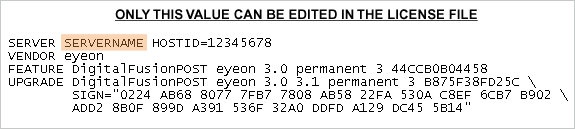
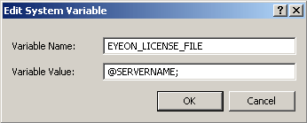
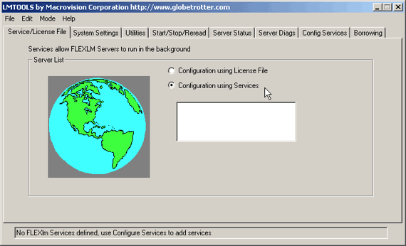
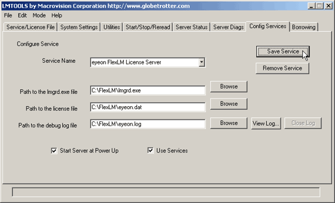
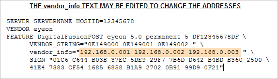

# Administering a License Server

We now have a video of this setup procedure to watch on our YouTube Channel [here.](https://www.youtube.com/watch?v=NjEu-05obAA)

Most facilities with more than one license of Fusion run a FlexLM license server, as this model provides the most flexibilty for distributing a fixed pool of licenses to multiple machines. It also eliminates the risk of loss or downtime associated with hardware lock based licensing.

Network licenses are available to any facility which owns three or more copies of Fusion, DFX+ or Fusion Render Slave at their facility. Contact a [sales representative](mailto:sales@eyeonline.com) for details on converting hardware lock licenses to floating licenses instead.

### Required Files

The files listed below can also be found on the Fusion install CD in a folder labeled FLEXlm. The versions linked below will likely be more recent however.

- LMGRD.exe (v 9.2.0)
- LMGRD.exe (v 11.4.1)

The license manager daemon (lmgrd) handles the initial contact with the client application programs, passing the connection on to the appropriate vendor daemon. It also starts and restarts the vendor daemons. A single lmgrd.exe can manage daemons from multiple vendors.

[EYEON.exe](http://web.eyeonline.com/Web/EyeonWeb/Downloads/network_licenses/network_licenses.aspx)

The eyeon vendor daemon. This file is managed by the manager daemon, and contains the actual licensing code required by Fusion.

- LMTOOLS.exe (v 9.2.0)
- LMTOOLS.exe (v 11.4.1)

A GUI interface for managing the license server.

- Globetrotter User Manual (PDF)(9.2.0)
- Globetrotter User Manual (PDF)(11.4.1)

The Macrovision FLEXLm Network License manual. Highly recommended for network administrators.

[Dongle Drivers](../ftp.aladdin.com/pub/hasp/hl/windows/installed/redistribute/drivers/HASP_HL_driver_setup.zip)

The Aladdin device driver for the HASP hardware lock which must be present on the license server.

[All Files](http://web.eyeonline.com/Web/EyeonWeb/Downloads/network_licenses/network_licenses.aspx)

A zip file containing all of the 9.2.0 files mentioned on this page (except the license file).

## Installing the License Server

A hardware lock can be provided with a license server, or the license can be tied to the license servers MAC address. If you have received a  hardware lock, it must to be connected to the computer chosen to act as the license server. Ensure that this machine is running Windows NT, Windows 2000, Windows XP, or Server 2003.

Note: Unless Fusion has previously been installed on this computer, it will be necessary to install the HASP drivers for the hardware lock. See the downloads section above.

Copy or save *eyeon.exe*, *lmgrd.exe*, *lmtools.exe* and your *EXAMPLE.dat* file into a directory. We usually recommend creating a directory on the root of C: to put these files in a folder named FlexLM (C:\FlexLM) but any directory could be used.

Open the *EXAMPLE.dat* license file, and modify the first line. Replace the word *servername* with the actual network name of the license server. Save the file. Note that *servername* is the one of the few portions of the license file that can be modified without invalidating the license. Everything else must be left as is.

Now it is time to run the license server. From the command prompt, navigate to the C:\FlexLM folder (or relevant folder) and run the following command.

`C:\FlexLM>lmgrd -c EXAMPLE.dat`

The license server should start and the status of the server should be indicated in the log, a text file in the folder containing the eyeon.exe daemon.

### Setting up the Client Workstations

On each workstation that will access the license server an environment variable called *EYEON_LICENSE_FILE* must be added to the system. The variable should be set to *@SERVERNAME*; where *SERVERNAME* is the network name of the license server. An IP address can also be used , such as @192.168.0.21;. Don't forget the semicolon at the end!

To add an environment variable in Windows, select Start > Settings > Control Panel, and choose the System option and open the Advanced Tab. Click on the button labeled Environment Variables. Click on the New button under the 'System Variables' section of the dialog that appears, and enter the name and value of the variable (as pictured right).

It should now be possible to start Fusion without a hardware lock attached to the workstation .

## Installing the license server as a service

Now that the FlexLM license server is working properly, it may be advantageous to install the license server as a service. A service is usually started at when the computer starts up, and is available even when no user is logged in to the computer.

The *lmtools.exe* application makes it very easy to configure the license server as a service. Start *lmtools.exe*, then select "Configuration Using Services" from the radio button options in the "Service/License File" tab.

Now switch to the "Config Services" tab, and note the controls that appear. The first is a drop down menu labeled Service Name. Unlike many drop down menus it is possible to edit the contents of this control.

The default value of 'FlexLM Service 1' is not terribly informative. Change the name by clicking in the control area and entering a more descriptive name. 'eyeon FlexLM License Server' is a good choice.

Look at the control labeled "Path to the lmgrd.exe file". Click on the browse button to the left of the control and locate the lmgrd.exe file installed previously.

The next control requires a path to the license file on disk. The browse button will display a dialog that defaults to showing only files with the *.lic extension. Click on the 'files of type' menu and select *.dat to show the license files used by Fusion.

The third control requires the path and name of the file to use for the log that is written by the service as it runs. This file contains all of the messages and errors normally output to the console. Note that the logfile will be created automatically when the license server service starts.

Finally, select the "Use Services" checkbox, then enable the checkbox labeled "Start Server at Powerup".

When all of these controls are set correctly select the "Save Service" button at the top of the screen. The service will be installed into Windows, and will start the next time the computer is booted. Either reboot the system, or start the service using the `Start > Settings > Control Panel > Administrative Tools > Services` dialog.

### Serial Number Routing

Another issue that might arise when using network licenses involves the provision of unique serial numbers for your copies of Fusion. When Fusion is licensed to a hardware lock it retrieves an eight character hexadecimal serial number physically encoded into the hardware lock. When running Fusion off of a license server, the serial number is unassigned, or `00000000`.

Unfortunately the licensing systems employed by some third-party plug-ins depend on each license of Fusion providing a unique serial number.

To accommodate this a network license file can be encoded with serial numbers and IP addresses. When a copy of Fusion is launched from an IP address in the license file, the serial number which matches the IP address is automatically assigned to that Fusion.

The IP addresses within the license file **`vendor_info`** field can be edited to match the actual IP addresses used on the network without invalidating the license. The IP addresses in this string are matched to the corresponding serial numbers within the **`VENDOR_STRING`** field. Only existing IP addresses may be changed, without additions or deletions. No other fields may be modified, apart from the Server name on the first line. The number of assignable serial numbers is limited to the number of licenses.

- Serial number routing can use either IP addresses or machine names in Fu5 or greater. DF4 or earlier can only use IP addresses.

If a network license with serial number routing is required, please contact [technical support](mailto:tech@eyeonline.com).

- Fusion x64 does not support serial routing
- As of Fusion 6, serial routing has been deprecated as all current 3rd party plugins offer their own network licensing systems.

