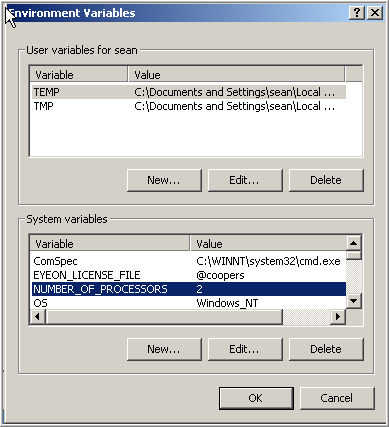

# Installing the License

## Installing The License File

Fusion uses the FlexLM licensing system for licensing software. This system is a popular, flexible licensing format that is commonly used in the graphics and post production industries. For details on the FlexLM licensing format beyond the notes in this section, visit their homepage at [www.macrovision.com](http://www.macrovision.com/).

## Network Licensing

When Fusion starts, it will first look to see if the HASP hardware lock is attached to the computer. The hardware lock provides Fusion with an eight-digit serial number for license authentication. If the hardware lock is not present, Fusion will look for a network license by checking for the name of a server in the `EYEON_LICENSE_FILE` variable.

If no network license server is specified, an error message will appear with the message that a hardware lock was not found for this copy of Fusion.

If a hardware lock is found, Fusion will look for a license file called fusion.dat, which contains a license that matches the serial number of the hardware lock. This is normally located in the same directory as the application executable (`Fusion.exe`).

Once the license is found, Fusion examines the license to see if it is valid. If the license is for the correct serial number and version of the software and if it has not expired, Fusion will then start.

## Finding The License

Fusion searches the following locations (in order) for a license file named `Fusion.dat`.

### Application Directory

The application directory is the directory where the Fusion or DFX+ executable is stored on the drive.

### FlexLM Directory

FlexLM will always search the `C:\FlexLM` directory for a copy of the license. This is generally a good place to store the license if there are multiple versions or installations of the software.

### Environment Variable

If an environment variable called `EYEON_LICENSE_FILE` is present, Fusion will search for the license in the directories listed in that variable's value. For example, if `EYEON_LICENSE_FILE` has the value `C:\Fusion\License;E:\Licenses`, Fusion will search in the two directories specified for a copy of the license file. The `EYEON_LICENSE_FILE` variable is also used to specify the path to a license server, as described in

## Administering a License Server.

### Combining Licenses

If there are several copies of Fusion, keeping track of which Fusion.dat file goes with which hardware lock can become a chore. The solution is to combine the license files into one super - dat file that contains all of the licenses for all of the hardware locks.

Create a new document in Notepad or the plain ASCII text editor of your choice. Never use MS Word, Wordpad or other word processors to create or edit license files. Now open each of the licenses with the text editor and copy the contents into the new document. Leave a line between each entry. Save the resulting file as `fusion.dat` (taking care not to overwrite an existing file).

When Fusion finds a combined license file with multiple entries, it will ignore all licenses in the file except the one that matches its current serial number.

### Licenses and Older Versions

Fusion licenses are backwards compatible. This means that a Fusion 5 license can also be used to start instances of Fusion 4, Fusion 3 and Fusion 2.5. Before Fusion 5, the license files name was `DFusion.dat`. Therefore, when running older versions of Fusion with a Fusion 5 license it is important to be certain the file is named `DFusion.dat`. Fusion 5 will find license files with either name, so in such cases it makes the most sense to place the license file in either `C:\FlexLM` or a path specified by the environment variable `EYEON_LICENSE_FILE`.

## Network Licensing

If there are three or more licenses of any eyeon Software products, you may be eligible to use FlexLM based Floating Licenses instead of hardware locks. See [Administering a License Server](index14b5.html?title=Eyeon:Manual/Administering_a_License_Server) for more details.
 
